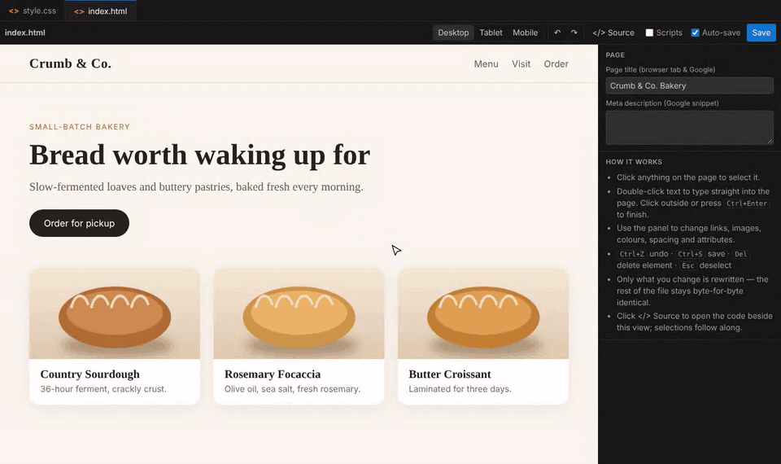
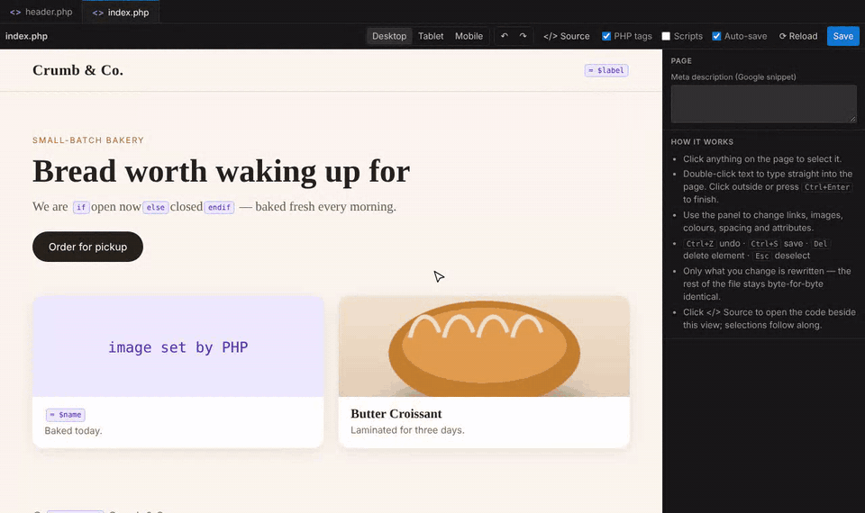

# Bready Visual HTML Editor

**Edit HTML and PHP pages visually, right inside VS Code.** Click anything on your page to select it, double-click text to type straight into it, and change fonts, colours, links and images from a side panel. Every change is saved into your source file.

Only the part you changed is rewritten. Indentation, comments, quoting and your PHP code stay exactly as they were, so your git diffs show just your real edits.

## What's new in 1.3

- **PHP pages.** Open `.php` files visually. Header and footer includes are shown, PHP code is protected, and Google Fonts links go into the right file. [See below ↓](#php-pages)
- **Font picker.** Choose from the fonts on your page, popular Google Fonts or system fonts, each previewed in its own typeface.
- **⟳ Reload.** Go back to the last saved version and refresh the preview.

## Features

### Edit right on the page
- **Click** any element to select it. A breadcrumb shows where it sits (`body › section › h1`), so you can step up to its parent.
- **Double-click** text to type into it. Bold, italic, underline and links are available while you type.
- **Move up / down, duplicate, delete**, or **add** headings, paragraphs, buttons, images, lists and sections.
- **Page settings:** page title and meta description (the Google snippet).

### Style it from the side panel
- **Font picker** with three groups:
  - fonts already used on your page
  - 28 popular **Google Fonts**, with the stylesheet link added for you
  - system fonts that need no download

  You can also type any font name.
- **Colour and background** with a colour picker, plus font size, weight and alignment.
- **Spacing and shape:** padding, margin, width and corner radius.
- **Links:** address and "open in new tab".
- **Images:** file, alt text and **Replace image…**, which copies the new picture into your project.
- **Everything else:** id, classes, every attribute, and the element's own HTML for quick code-level fixes.

### See it the way visitors will
- **Your real CSS, images and fonts** load from your project, and the preview refreshes when you change them.
- **Desktop / Tablet / Mobile** preview widths.
- **Scripts** toggle to run the page's own JavaScript when you need it.

### Saves safely
- **Auto-save** writes each change to the file, or turn it off and press Ctrl/Cmd+S yourself.
- **⟳ Reload** returns to the last saved version. It asks first if you have unsaved changes, and Undo still brings them back.
- **Works with VS Code itself:**
  - undo/redo, the unsaved-changes dot, git and Live Share all behave normally
  - edits in the text editor appear in the visual view, and the other way round
  - selecting an element highlights its code in the source editor (**</> Source**)

## PHP pages

- **PHP never runs.** Code that prints something, like `<?= $name ?>` or `echo …`, shows as a small purple tag where its output goes. `if`/`else` inside a sentence is tagged too. The **PHP tags** toggle hides the tags.
- **Includes are shown.** Files loaded with `include` / `require`, such as `header.php`, `footer.php` and `nav.php`, are pulled in, so you see the whole page with its CSS. Click an included part to open that file in the visual editor.
- **Your PHP is protected:**
  - every PHP block is kept exactly as written, including inside attributes like `href="<?= $url ?>"`
  - fields that contain PHP are read-only
  - a text edit that would delete PHP code is refused
- **Fonts work site-wide.** If the page's `<head>` lives in `header.php`, the Google Fonts link is added there.
- **Images set by PHP** (`src="images/<?= $img ?>.jpg"`) show a placeholder.

## How to use

1. Open your website folder in VS Code (**File → Open Folder…**).
2. Open an `.html` or `.php` file and click the **✎ Open in Visual Editor** button in the editor's title bar. You can also right-click the file in the Explorer and choose **Open in Visual Editor**.
3. Click, double-click, edit. Use **</> Source** to see the code beside it.

**Tip:** to always open these files visually, right-click an `.html` or `.php` file → **Open With…** → **Configure default editor for…** → **Bready Visual HTML Editor**.

| Shortcut | Action |
|---|---|
| Double-click / Enter | Edit the selected element's text |
| Ctrl/Cmd + Enter | Finish editing text |
| Esc | Cancel text edit / deselect |
| Delete | Delete the selected element |
| Ctrl/Cmd + D | Duplicate the selected element |
| Ctrl/Cmd + Z / Shift+Z | Undo / redo |
| Ctrl/Cmd + S | Save |

## Settings

| Setting | Default | Description |
|---|---|---|
| `breadyVisualHtml.autoSave` | `true` | Save the file after every visual edit |
| `breadyVisualHtml.runScripts` | `false` | Run the page's own `<script>` tags in the preview |

## Good to know

- The editor changes the HTML that's **in the file**. Content created by JavaScript at runtime can't be edited visually, and neither can frameworks like React, Vue or Next.js.
- For PHP pages, the preview shows the HTML around your PHP, not what the PHP outputs when the site runs. A loop shows its template once. To change PHP logic, use **</> Source**.
- Style changes are saved as an inline `style=""` on that element. They are not written into your CSS file.
- Page scripts are off in the preview by default so the page stays still while you edit. Inline handlers such as `onclick="…"` never run in the preview.

## Support

Found a bug or have an idea? [Open an issue](https://github.com/breadywebstudios/bready-visual-html-editor/issues) or email **breadywebstudios@gmail.com**.

---

Made by [Bready Web Studios](https://breadywebstudio.vercel.app)
